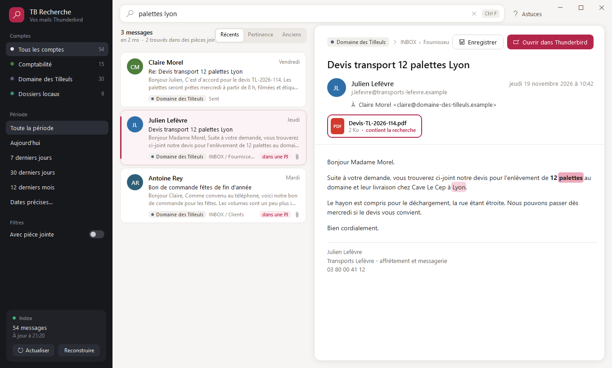
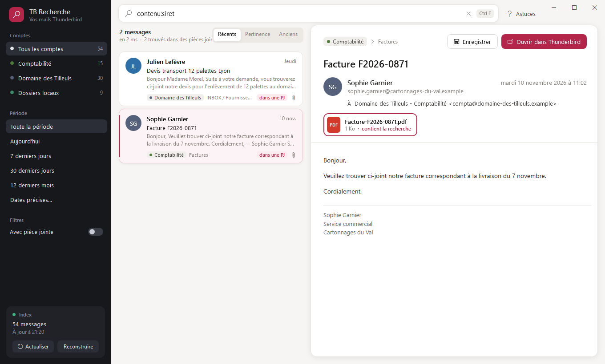
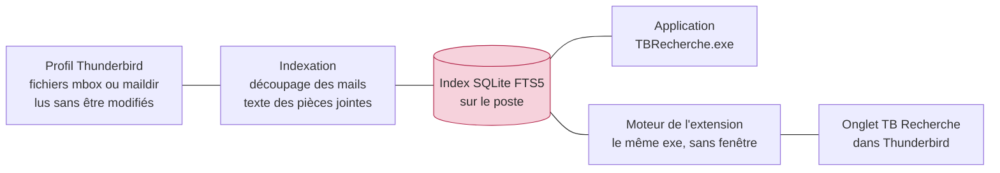

# TB Recherche

Recherche instantanée dans tous les mails de Thunderbird **et dans le contenu de leurs pièces jointes** : un devis PDF, un bon de commande Word ou un tarif Excel sont trouvés par ce qu'ils contiennent, pas seulement par leur nom.

Les résultats s'affichent pendant la frappe, en quelques millisecondes, même sur des dizaines de milliers de messages. Tout reste sur le poste : TB Recherche lit le profil Thunderbird en lecture seule et n'envoie rien nulle part.



<sub>Les captures utilisent un profil de démonstration aux noms et adresses inventés (voir [docs/demo](docs/demo)).</sub>

## Ce que ça apporte

- **Le texte des pièces jointes est cherché** : PDF, Word, Excel, PowerPoint, OpenDocument, texte, CSV, HTML, RTF. La carte du résultat indique « dans une PJ » et la pièce jointe concernée est encadrée dans le message.
- **Une seule recherche pour tous les comptes** et tous les dossiers, avec un filtre par compte, par période ou « avec pièce jointe ».
- **Les mots cherchés sont surlignés** dans la liste et dans le mail.
- **Le mail s'affiche comme dans Thunderbird**, en HTML, mais sans scripts et sans images distantes (pixels de suivi) tant qu'on ne les a pas autorisées pour ce message.
- **Un clic ouvre le vrai message dans Thunderbird** pour répondre, transférer ou classer.
- **Deux façons de s'en servir** : l'application Windows, ou un onglet directement dans Thunderbird grâce à l'extension.

## Chercher dans le contenu des pièces jointes

Le préfixe `contenu:` limite la recherche au texte des pièces jointes. Ici, le numéro SIRET n'apparaît dans aucun mail : il est dans la facture PDF et dans le devis PDF.



## Dans Thunderbird

L'extension ajoute un bouton **Recherche** (raccourci Ctrl+Alt+R) qui ouvre le même moteur dans un onglet de Thunderbird. « Ouvrir » affiche le message d'origine, « Voir dans le dossier » le sélectionne dans son dossier.

Ci-dessous, « palettes » n'est écrit nulle part dans le mail d'Antoine Rey : le mot est dans le bon de commande Word joint.


<sub>Page de l'extension rendue hors de Thunderbird, avec de vraies réponses du moteur (`tbr hostdump`).</sub>

## Installation

Télécharger les deux fichiers de la dernière version dans [Releases](../../releases) :

| Fichier | Rôle |
|---|---|
| `TBRecherche.exe` | l'application, autonome : rien à installer, .NET est inclus |
| `tb-recherche.xpi` | l'extension Thunderbird (facultative), version 128 ou plus récente |

1. Ranger `TBRecherche.exe` dans un dossier stable (par exemple `C:\Outils\TB Recherche`) et le lancer. Le profil Thunderbird est trouvé tout seul, y compris les comptes rangés hors du profil. La première indexation prend quelques minutes, la recherche est utilisable pendant ce temps.
2. Pour l'extension : dans Thunderbird, menu Outils, Modules complémentaires et thèmes, roue dentée, « Installer un module depuis un fichier », puis choisir `tb-recherche.xpi`.

L'exe doit avoir été lancé au moins une fois depuis son emplacement définitif : c'est à ce moment qu'il se déclare auprès de Thunderbird comme moteur de l'extension. S'il est déplacé, il suffit de le relancer.

Pour forcer un autre profil : `TBRecherche.exe --profile "D:\Thunderbird\xxxxxxxx.default-release"`.

## Syntaxe de recherche

Tous les mots sont obligatoires et cherchés en début de mot, sans tenir compte des accents ni des majuscules.

| Saisie | Effet |
|---|---|
| `facture dupont` | les deux mots, dans le mail ou ses pièces jointes |
| `"bon de commande"` | l'expression exacte |
| `facture -relance` | exclut un mot |
| `devis OU facture` | l'un ou l'autre |
| `de:dupont` / `a:martin` | expéditeur / destinataires (À et Cc) |
| `objet:commande` / `corps:palette` | objet / texte du message |
| `pj:pdf` | nom des pièces jointes |
| `contenu:siret` | uniquement dans le texte des pièces jointes |
| `dossier:douanes` | limite à un dossier |

Raccourcis : Ctrl+F pour revenir à la recherche, flèches haut et bas pour parcourir les résultats, Entrée ou double-clic pour ouvrir dans Thunderbird, Échap pour effacer.

## Comment ça marche



1. **Lecture du profil.** `profiles.ini` et `prefs.js` donnent la liste des comptes et l'emplacement de leurs dossiers. Seuls les fichiers de messages sont lus, jamais écrits.
2. **Découpage des mails.** Chaque fichier mbox est découpé en messages par un lecteur maison (Thunderbird récent écrit des séparateurs que les bibliothèques courantes ne reconnaissent pas). Pour chaque message, l'index retient sa position dans le fichier : rien n'est copié.
3. **Texte des pièces jointes.** Le texte des PDF (PdfPig) et des documents Office ou OpenDocument est extrait en mémoire, jusqu'à 25 Mo par fichier et 80 pages par PDF.
4. **Index plein texte.** Expéditeur, destinataires, objet, corps, noms et contenu des pièces jointes sont indexés dans SQLite FTS5, en mode « sans contenu » : l'index sait où sont les mots, il ne garde pas une copie des mails. Environ 110 Mo pour 37 000 messages.
5. **Mise à jour incrémentale.** Au démarrage puis toutes les 5 minutes, seuls les dossiers modifiés sont relus.
6. **Affichage.** Le message choisi est relu directement dans le fichier mbox à sa position, puis affiché dans un cadre isolé (WebView2), scripts bloqués.
7. **Extension.** Elle dialogue avec `TBRecherche.exe` par le « native messaging » de Thunderbird. L'application et l'extension partagent le même index ; un verrou empêche deux indexations simultanées.

## Confidentialité

- Ni compte, ni serveur, ni télémétrie : TB Recherche ne se connecte à rien. Seules les images distantes d'un mail se chargent, et uniquement quand on clique sur « Afficher les images ».
- Le profil Thunderbird est ouvert en lecture seule.
- Les images distantes des mails sont bloquées par défaut, ce qui neutralise les pixels de suivi.
- L'index et les copies temporaires restent dans le profil Windows de l'utilisateur.

## Où sont les données

- Index : `%LOCALAPPDATA%\TBRecherche\index.db`. On peut le supprimer, il se reconstruit (une quinzaine de minutes pour 13 Go de mails avec l'extraction des PJ).
- Journal du moteur de l'extension : `%LOCALAPPDATA%\TBRecherche\host.log`.
- Copies temporaires (affichage, `.eml` ouverts dans Thunderbird, PJ ouvertes) : `%TEMP%\TBRecherche`.

## Limites connues

- Seuls les dossiers IMAP **synchronisés hors ligne** sont visibles : les autres n'existent pas sur le disque.
- Les PDF scannés (images sans couche texte) ne sont pas lisibles : pas d'OCR.

## Développement

Prérequis : SDK .NET 8 (`winget install Microsoft.DotNet.SDK.8`), Windows 64 bits.

```
src\TBRecherche.Core   moteur : profil, découpage mbox, extraction PJ, indexation, recherche, rendu HTML, hôte de l'extension
src\TBRecherche        interface WPF (Theme.xaml, MainWindow) ; l'exe sert aussi d'hôte quand Thunderbird le lance
src\TBRecherche.Cli    outil de test tbr : accounts | index [--full] | search | show | verify | host | hosttest | hostdump
extension\             extension Thunderbird Manifest V3 (manifest.json, search.html/css/js, background.js)
docs\demo\             générateur du profil de démonstration utilisé pour les captures
```

Compiler l'exe (fenêtre de l'application fermée, et Thunderbird fermé si l'extension utilise cet exe) :

```
dotnet publish src\TBRecherche -c Release -o dist
```

Empaqueter l'extension : zipper le **contenu** du dossier `extension` (manifest.json à la racine de l'archive) et renommer en `dist\tb-recherche.xpi`.

Tester sans toucher à son propre index : `--db` donne un autre fichier d'index, à l'application comme à `tbr`.

```
python docs\demo\gen_demo.py C:\Temp\demo\profil
tbr index --full --profile C:\Temp\demo\profil --db C:\Temp\demo\index.db
TBRecherche.exe --profile C:\Temp\demo\profil --db C:\Temp\demo\index.db
```

Points de vigilance :

- `tbr verify` compare, fichier par fichier, le nombre de messages indexés au nombre de séparateurs `From ` du mbox. À relancer après toute modification du découpage : il doit annoncer 0 fichier en écart.
- La recherche ouvre l'index en lecture seule (`IndexDb.OpenRead`) : en mode WAL, elle n'attend jamais l'indexation. Revenir à une connexion en écriture figerait la saisie pendant les indexations.
- Ne pas tester l'hôte de l'extension avec PowerShell 5.1 (tuyaux défaillants) : utiliser `tbr hosttest`.
